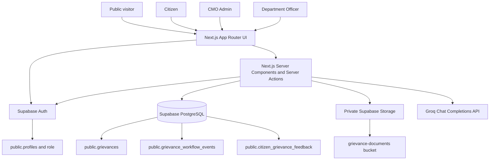

# System Architecture

This document describes the current implementation architecture of the CM Kerala Public Service Portal demonstration project. It reflects the application code and Supabase SQL setup scripts in this repository; it does not imply that the SQL has already been applied to a hosted Supabase project.

## Architecture at a glance

The browser renders public and authenticated pages. Authenticated mutations and privileged integrations are handled on the server. Supabase PostgreSQL row-level security (RLS) and Storage policies enforce data access boundaries independently of the visible UI.

## Frontend architecture

- **Framework:** Next.js App Router, React, TypeScript, and Tailwind CSS.
- `app/` contains route pages, root layout, server actions, authentication callbacks, and loading states.
- `components/` contains forms and UI shared across role-specific pages, including authentication, grievances, workflow controls, feedback, CMO officer invitations, and AI analysis.
- `lib/` contains shared role and domain types, server-side data queries, and Supabase client configuration.
- `app/page.tsx` is public and does not require an account. Role-protected dashboards are separate routes.
- Server Components load dashboard data on the server. Client Components provide interactive forms using React actions and action state.
- The root layout defines document metadata, fonts, and global styles; Tailwind CSS provides utility-based styling.

### Main user interfaces

| UI | Route | Main responsibilities |
|---|---|---|
| Public home | `/` | Explain portal services and link to sign-in and Citizen registration |
| Login | `/login` | Authenticate a Citizen or staff user |
| Citizen registration | `/register` | Create Citizen account and verify email |
| Officer registration | `/officer/register` | Complete invited registration or, in demo mode, public officer registration |
| Citizen dashboard | `/citizen/dashboard` | Submit grievances, view counts/history, search references, leave resolution feedback |
| CMO dashboard | `/cmo/dashboard` | Review, filter, assign, route, escalate, and monitor grievances |
| CMO AI analysis | `/cmo/ai-analysis` and `/cmo/ai-analysis/[id]` | Select a grievance and request advisory Groq analysis |
| Department dashboard | `/department/dashboard` | Review assigned queue, record investigation progress, submit reports, or forward cases |

## Backend architecture

There is no separately deployed Express, Django, or standalone REST backend in this project. The Next.js application provides the server-side application layer through:

- **Server Components** for authenticated page rendering and server-side data reads.
- **Server Actions** for form submissions and state-changing operations, including grievance submission, feedback, workflow actions, officer invitations, and AI analysis.
- **Route Handlers** for authentication callbacks, including Supabase confirmation and invitation verification.
- **`proxy.ts`** for Supabase session cookie refresh on incoming requests.

Server actions validate form inputs (primarily with Zod), verify the signed-in profile and role, use the session-bound Supabase server client, report errors, and revalidate affected routes after successful changes. Role checks in application code complement database RLS; they do not replace it.

### Supabase clients

- `lib/supabase/client.ts` creates a browser Supabase client using public URL/key configuration. It is intended for browser-safe Supabase operations.
- `lib/supabase/server.ts` creates a server Supabase client using request cookies, so data operations run with the authenticated user's session and are subject to RLS.
- The privileged service-role client is used only for workflows that need account administration, such as officer invitations and demo officer account creation. The service-role key must remain server-only.

## Database architecture

Supabase PostgreSQL stores account profiles, grievances, case history, and feedback. The SQL files under `supabase/` define schema, constraints, indexes, functions, grants, RLS policies, and Storage policies. Apply them in the order documented in the root [README](../README.md#supabase-setup).

### Main tables and data

| Table or resource | Purpose |
|---|---|
| `auth.users` | Supabase-managed authentication identities |
| `public.profiles` | Application profile, name, role, and optional department; profile rows are created by a private Auth trigger |
| `public.grievances` | Citizen complaint, reference ID, location/district, category, status, assignment, and attachment metadata |
| `public.grievance_workflow_events` | Append-style record of routing, investigation, reports, forwarding, CMO review, remarks, and escalation |
| `public.citizen_grievance_feedback` | A Citizen's single feedback response on a resolved grievance |
| `storage.objects` / `grievance-documents` | Private uploaded grievance and investigation documents, governed by Storage RLS policies |

The grievance's `citizen_category` stores the category selected by the Citizen. The separate `category` and `priority` fields store AI-suggested classifications for CMO review and filtering.

### Access control

- Row-level security is enabled for application records and policies scope reads and writes by authenticated user, role, ownership, department, and officer assignment.
- Citizens can read their own grievances and Citizen-visible workflow events. Internal CMO remark and escalation event types are excluded from Citizen history.
- CMO Admin policies allow administrative review and management features.
- Department Officer access is limited to the officer's department and, where assigned, the individual officer.
- Feedback insert policies require that the signed-in Citizen owns the grievance and its current status is resolved. A unique constraint prevents a second feedback row for the same grievance.
- The document bucket is private. Authorized users receive short-lived signed URLs after server-side access checks.
- Workflow changes use database functions such as `apply_grievance_workflow_action` and `route_grievance_to_department` to perform role-checked updates and write event history transactionally.
- Dashboard summary metrics are provided by the `get_cmo_grievance_dashboard_metrics` database function.

RLS policies are a critical part of this design. Changing UI checks without corresponding database policy review is not sufficient to change authorization safely.

## API architecture

The application does not currently expose a general public REST API for grievance CRUD. Its API boundary consists of server actions, authentication route handlers, and Supabase's authenticated PostgREST/Storage endpoints.

### Request flows

#### Authentication

1. The browser submits credentials through the Supabase Auth client/form workflow.
2. Supabase verifies credentials and returns a session.
3. Session cookies are maintained using `@supabase/ssr` and refreshed by `proxy.ts`.
4. Protected server-rendered pages call the authentication/profile helpers to verify the current user, load `public.profiles`, and enforce the expected role.
5. Login/dashboard routing is based on `profiles.role`, not on a role chosen by the user.

#### Grievance submission

1. The Citizen's browser submits form data to the `submitGrievance` server action.
2. The action verifies the Citizen role, validates fields and file type/size, and checks PDF/JPEG file signatures.
3. If present, the document is uploaded to the private Supabase Storage bucket using an owner/case-scoped path.
4. The grievance row is inserted through the session-bound Supabase client. The database creates the reference ID and RLS checks ownership.
5. If the database insert fails after upload, the action attempts to remove the uploaded object and reports cleanup errors explicitly.
6. On success, affected dashboard paths are revalidated and the reference ID is returned to the form.

#### Workflow updates

1. An authenticated CMO Admin or Department Officer submits a workflow form to the appropriate server action.
2. The action checks role, validates the requested operation, and optionally uploads a validated officer PDF.
3. It calls a role-checked PostgreSQL RPC. The RPC validates the current case state and actor, then updates the grievance and appends the workflow event as a transaction.
4. A failed RPC triggers cleanup of an uploaded file when possible; errors are returned rather than represented as success.
5. Successful updates revalidate the Citizen, CMO, Department, and AI analysis views.

#### Reference search and counts

- The Citizen dashboard validates the reference ID format and queries using the signed-in Citizen's session.
- Grievance RLS ensures that the lookup returns only records owned by that Citizen; no anonymous reference lookup endpoint is provided.
- Total, pending, and resolved dashboard counts use separate exact-count queries, also subject to the same user's RLS.

### Main server actions

| Action | Authorized role | Function |
|---|---|---|
| `submitGrievance` | Citizen | Validate and create a grievance, optionally upload an attachment |
| `processGrievanceWorkflowAction` | CMO Admin or Department Officer, action-dependent | Route, record progress, report, forward, review, remark, or escalate |
| `submitCitizenFeedback` | Citizen | Save one response for an owned resolved grievance |
| Officer invitation action | CMO Admin | Invite an officer through Supabase Auth and a protected callback |
| AI analysis action | CMO Admin | Load a grievance and duplicate candidates, call Groq, validate output, and persist suggested category/priority |

Server action names and signatures are application implementation details, not a versioned external API contract.

## AI architecture

The AI integration is an optional CMO-only server-side feature:

1. The action calls `requireRole("cmo_admin")` before loading case details or invoking Groq.
2. It loads the selected grievance and up to 100 recent comparison grievances from PostgreSQL using the signed-in user's Supabase session.
3. Candidate complaints are ranked locally for likely text overlap. The submitted complaint and selected candidate excerpts are scrubbed for email addresses and telephone numbers.
4. The server calls Groq's OpenAI-compatible Chat Completions endpoint at `https://api.groq.com/openai/v1/chat/completions`, using `GROQ_API_KEY` and the configured `GROQ_MODEL` (default: `openai/gpt-oss-20b`).
5. The request asks for strict structured JSON with an allowed department, category, Low/Medium/High priority, summary, duplicate references, and a duplicate reason.
6. The response is parsed and validated with Zod. Returned duplicate references are restricted to the known candidates.
7. Suggested category and priority are stored on the grievance for CMO dashboard filtering. The complete result is presented to the CMO for human review.

The AI feature does not route, assign, escalate, reject, or resolve a case. AI suggestions are not guaranteed to be accurate. The feature requires a server-side `GROQ_API_KEY`; without it, the action returns a configuration error. Do not send sensitive or real citizen data to a third-party model without appropriate legal, privacy, and project approval.

## External services and secrets

| Service | Use | Credentials |
|---|---|---|
| Supabase Auth | Signup, email verification, sign-in, session, and officer invitation | Public URL/key plus server-only service role key for privileged account operations |
| Supabase PostgreSQL / PostgREST | Profiles, grievances, events, feedback, and RPC operations | Authenticated session-bound Supabase client; RLS enforced |
| Supabase Storage | Private grievance and investigation attachments | Authenticated session and Storage RLS; short-lived signed URLs |
| Groq API | Optional CMO grievance analysis | Server-only `GROQ_API_KEY` |

Local values belong in `.env.local`; deployment values should be configured in the hosting provider's secret/environment settings. Never commit secrets or expose privileged keys through `NEXT_PUBLIC_` variables.

## Operational boundaries and limitations

- Deploying the Next.js application does not apply the Supabase SQL scripts. Database setup must be performed separately in the intended Supabase project.
- Auth email templates, SMTP, Site URL, redirect URLs, Storage, and Data API exposure require Supabase project configuration.
- Automatic email/SMS grievance notifications are not implemented.
- Reference search requires an authenticated Citizen account; public lookups are intentionally unsupported.
- Public officer registration is intended only for non-sensitive demonstrations and must remain disabled in a production deployment.
- The project is a demonstration and is not an official government service or a production security/compliance certification.

