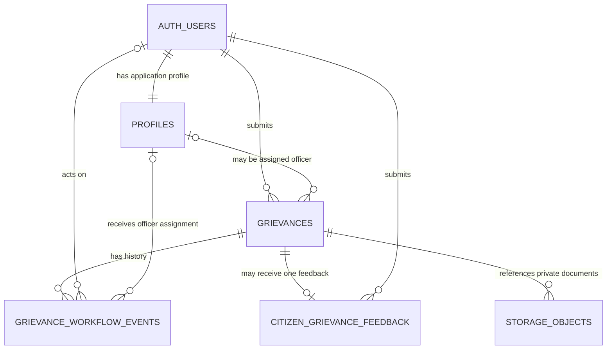

# Database Design

This document describes the database defined by the Supabase SQL scripts in `supabase/`. It describes the repository's intended schema; it does not confirm that the scripts have been applied to a hosted Supabase project.

## Database platform and setup

- **Database:** Supabase PostgreSQL.
- **Authentication identities:** Supabase-managed `auth.users`.
- **Application schema:** `public`, with a restricted `private` schema for internal trigger/helper functions.
- **File storage:** Supabase Storage private bucket `grievance-documents`; object metadata is managed by Supabase in `storage.objects`.
- **Schema installation order:** `schema.sql` → `grievances.sql` → `grievance-workflow.sql` → `cmo-dashboard.sql` → `citizen-portal.sql`.

The schema uses UUID primary keys for application records, PostgreSQL foreign keys, check constraints for enumerated states and bounded text, indexes for common list/filter operations, and RLS policies for access control.

## Entity relationship diagram

`AUTH_USERS` and `STORAGE_OBJECTS` represent Supabase-managed resources rather than tables created by the application's own SQL scripts. A grievance may have one original attachment path, and workflow events may each reference an investigation PDF.

## Entities and tables

### `auth.users` — Supabase-managed authentication identities

Supabase Auth owns this table. It stores login identity and verification/session-related account data. The application references its UUID but does not define or manage this table in its SQL scripts.

When an Auth user is created, a database trigger calls `private.handle_new_user()` and creates a profile with the default `citizen` role. Existing Auth users without a profile are also backfilled by `schema.sql`.

### `public.profiles` — application profile and role

| Column | Type | Constraints / meaning |
|---|---|---|
| `id` | `uuid` | Primary key and foreign key to `auth.users.id`; cascade delete |
| `full_name` | `text` | Required; defaults to empty string |
| `role` | `text` | Required; defaults to `citizen`; allowed values: `citizen`, `cmo_admin`, `department_officer` |
| `department` | `text` | Nullable; populated for Department Officers |
| `created_at` | `timestamptz` | Required; defaults to current time |

The public Citizen registration flow does not accept a role. Administrative role promotion is performed through a trusted process. A profile may be referenced by `grievances.assigned_officer_id` and `grievance_workflow_events.to_officer_id`.

### `public.grievances` — grievance case

The base table is created by `grievances.sql`; workflow, CMO, and Citizen scripts extend it.

| Column | Type | Constraints / meaning |
|---|---|---|
| `id` | `uuid` | Primary key; defaults to `gen_random_uuid()`; application may supply it for attachment path construction |
| `reference_id` | `text` | Required, unique, database-generated `GRV-` prefix plus 12 uppercase hexadecimal characters |
| `citizen_id` | `uuid` | Required foreign key to `auth.users.id`; cascade delete |
| `topic` | `text` | Required; 3–120 characters |
| `citizen_name` | `text` | Required; 2–150 characters |
| `location` | `text` | Required; 2–300 characters |
| `district` | `text` | Nullable; limited to the 14 Kerala districts |
| `citizen_category` | `text` | Nullable at database level; limited to the Citizen-facing category values |
| `content` | `text` | Required; 20–5,000 characters |
| `category` | `text` | Nullable AI-suggested category; 2–100 characters |
| `priority` | `text` | Nullable AI-suggested priority: `Low`, `Medium`, or `High` |
| `status` | `text` | Required; defaults to `submitted`; allowed workflow states are listed below |
| `assigned_department` | `text` | Nullable; limited to the configured department list |
| `assigned_officer_id` | `uuid` | Nullable foreign key to `profiles.id`; set null if profile is deleted |
| `attachment_path` | `text` | Nullable private Storage object path |
| `attachment_name` | `text` | Nullable original/safe display filename |
| `attachment_mime_type` | `text` | Nullable; when set, consistent attachment metadata allows `image/jpeg` or `application/pdf` |
| `created_at` | `timestamptz` | Required; defaults to current time |

The original attachment fields must be either all null or include path, name, and supported MIME type. Original Citizen attachments accept JPG/JPEG or PDF files, up to 10 MB in application and bucket configuration.

The grievance status values are:

- `submitted`
- `under_review`
- `assigned`
- `in_progress`
- `action_report_submitted`
- `resolved`
- `rejected`

`citizen_category` stores the category selected by the Citizen. `category` and `priority` are separate so AI classification does not overwrite the Citizen's selection.

### `public.grievance_workflow_events` — case history

This table is created by `grievance-workflow.sql` and extended in later scripts.

| Column | Type | Constraints / meaning |
|---|---|---|
| `id` | `uuid` | Primary key; defaults to `gen_random_uuid()` |
| `grievance_id` | `uuid` | Required foreign key to `grievances.id`; cascade delete |
| `actor_id` | `uuid` | Nullable foreign key to `auth.users.id`; set null if the actor account is deleted |
| `event_type` | `text` | Required; constrained to recognized workflow event types |
| `note` | `text` | Nullable; maximum 3,000 characters |
| `from_department` | `text` | Nullable; constrained to the configured department list |
| `to_department` | `text` | Nullable; constrained to the configured department list |
| `to_officer_id` | `uuid` | Nullable foreign key to `profiles.id`; set null if profile is deleted |
| `status_after` | `text` | Required; records the case status after the event |
| `attachment_path` | `text` | Nullable private investigation PDF path |
| `attachment_name` | `text` | Nullable display filename; consistent with attachment path |
| `created_at` | `timestamptz` | Required; defaults to current time |

Recognized event types include:

- `cmo_routed`
- `officer_progress`
- `department_report`
- `department_forwarded`
- `cmo_reviewed`
- `cmo_remark`
- `cmo_escalated`
- `cmo_assigned_officer`

Event writes for the main case workflow are performed by role-checked PostgreSQL RPC functions. The `cmo_remark` and `cmo_escalated` event types are internal and excluded from Citizen-visible history. Investigation event attachments are PDFs; the officer workflow accepts them up to 10 MB.

### `public.citizen_grievance_feedback` — resolution feedback

Created by `citizen-portal.sql`.

| Column | Type | Constraints / meaning |
|---|---|---|
| `id` | `uuid` | Primary key; defaults to `gen_random_uuid()` |
| `grievance_id` | `uuid` | Required, unique foreign key to `grievances.id`; cascade delete; enforces at most one feedback per grievance |
| `citizen_id` | `uuid` | Required foreign key to `auth.users.id`; cascade delete |
| `feedback` | `text` | Required; trimmed length 3–2,000 characters |
| `created_at` | `timestamptz` | Required; defaults to current time |

RLS restricts feedback reads to its Citizen and permits insertion only when that Citizen owns the grievance and its status is `resolved`.

### Supabase Storage resources

`grievances.sql` creates the private `grievance-documents` bucket with a 10 MB file size limit and JPG/PDF MIME type allowlist. The bucket stores both Citizen grievance attachments and Department Officer investigation PDFs.

Storage object paths are scoped by uploader and grievance ID. Policies restrict upload and read access; authorized application code creates short-lived signed URLs for viewing. Object records are maintained by Supabase in `storage.objects`, not by a project-defined attachment table.

## Relationships

1. **Auth user → profile:** `profiles.id` is a one-to-one primary/foreign-key relationship to `auth.users.id`.
2. **Auth user → grievance:** Each grievance has one submitting Auth user through `grievances.citizen_id`; a user can submit many grievances.
3. **Profile → assigned grievance:** `grievances.assigned_officer_id` optionally references the officer's profile; one officer can be assigned many grievances.
4. **Grievance → workflow event:** A grievance can have many workflow events; deleting the grievance cascades to its events.
5. **Auth user → workflow event:** An event may identify the acting Auth user; deletion of that user sets `actor_id` to null.
6. **Profile → event recipient:** A workflow event may identify an assigned officer through `to_officer_id`; deletion sets it to null.
7. **Grievance → feedback:** A grievance may have zero or one feedback row due to the unique constraint on `grievance_id`.
8. **Auth user → feedback:** A Citizen can submit feedback rows for their resolved grievances; ownership is also checked by RLS.
9. **Grievance → Storage objects:** Grievance and event attachment paths point to objects in the private bucket. The paths are stored as text rather than enforced by a PostgreSQL foreign key to `storage.objects`.

## Indexes and query support

The SQL scripts create indexes for frequent access patterns:

- `grievances_citizen_created_idx` — a Citizen's recent submissions.
- `grievances_department_created_idx` — department case queues.
- `grievances_created_idx` — newest-first grievance lists.
- `grievances_attachment_path_idx` — matching original attachment paths.
- `grievance_workflow_events_case_created_idx` — chronological events for a grievance.
- `grievances_dashboard_district_status_idx` — district/status dashboard filtering.
- `grievances_dashboard_category_priority_idx` — AI category/priority filtering.
- `grievances_assigned_officer_idx` — officer-specific case listings.
- `citizen_grievance_feedback_citizen_created_idx` — feedback by Citizen and date.

## Database functions and triggers

- `private.handle_new_user()` — Auth trigger function that creates a default Citizen profile for a new Auth user.
- `public.apply_grievance_workflow_action(...)` — validates workflow actor, action, case state, and input, then updates a case and records its history transactionally.
- `public.route_grievance_to_department(...)` — performs CMO routing and optional officer assignment while recording workflow history.
- `public.get_cmo_grievance_dashboard_metrics()` — returns grouped CMO dashboard summary/statistics.
- `private.current_user_is_cmo_admin()` — helper used in CMO officer-profile access policies.

Function signatures and accepted action details are defined in the SQL source and may evolve. Application role checks complement, rather than replace, the authorization performed by database functions and RLS.

## Row-level security summary

| Resource | Intended access |
|---|---|
| `profiles` | User can read own profile; CMO Admin can read Department Officer profiles needed for assignment |
| `grievances` | Citizen reads own cases; CMO Admin reads all; Department Officer reads cases routed to their department and matching any individual assignment |
| `grievance_workflow_events` | CMO Admin reads staff history; assigned department/officer reads permitted staff history; Citizens read only public event types for owned grievances |
| `citizen_grievance_feedback` | Citizen reads own feedback and inserts only for an owned resolved grievance; unique constraint allows one response per case |
| `storage.objects` | Private bucket; authorized owner/staff access according to the associated case and uploader path |

RLS policy definitions are the source of truth for database authorization. Any schema or role changes should be reviewed together with grants, RLS, Storage policies, database functions, server actions, and the dashboard queries.

